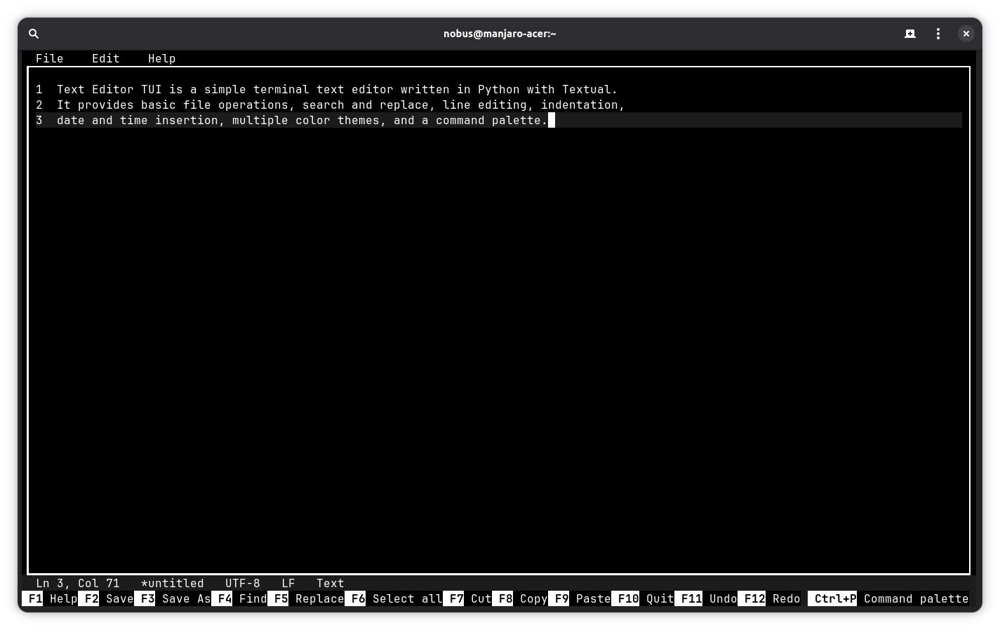

# Text Editor TUI



A simple terminal text editor written in Python with [Textual](https://textual.textualize.io/).

**Version 0.1.0 (2026.11).**

## Features

- Plain text editing with line numbers and multiple color themes.
- File actions: New, Open, Reopen, Save, Save As.
- Files are saved as `.txt` by default.
- Edit actions: Undo, Redo, Cut, Copy, Paste, Find, Replace, Select All, Remove Selection.
- Date and Time insertion.
- Indent and outdent selected lines.
- Line operations: Line Up/Down, Go to Line, Delete Line.
- Command palette (`Ctrl+P`) and clickable menus: File, Edit, Help.
- Four color themes (`default`, `green`, `magenta`, `blue`) with persistence between runs (Toggle Theme).
- Built-in keyboard shortcuts and About screens.

## Requirements

- Linux
- Python 3.10 or newer
- [Textual](https://pypi.org/project/textual/) 8 or newer

## Installation

```bash
cd application
python3 -m venv ../venv
../venv/bin/python -m pip install -e .
```

For development tools:

```bash
../venv/bin/python -m pip install -e ".[dev]"
```

## Running

```bash
../venv/bin/text_editor_tui [FILE]
```

Or from a checkout without installing the package:

```bash
cd application
PYTHONPATH=src ../venv/bin/python -m text_editor_tui [FILE]
```

Command-line options:

| Option | Description |
| :--- | :--- |
| `-h`, `--help` | Show help information and exit. |
| `-v`, `--version` | Show version information and exit. |

## Keyboard shortcuts

### File

| Action | Shortcut |
| :--- | :--- |
| New File | `Ctrl+N` |
| Open... | `Ctrl+O` |
| Reopen | `Ctrl+Shift+O` |
| Save | `Ctrl+S`, `F2` |
| Save As... | `Ctrl+Shift+S`, `F3` |
| Toggle Theme | `Alt+T` |
| Quit | `F10` |

### Edit

| Action | Shortcut |
| :--- | :--- |
| Undo | `Ctrl+Z`, `F11` |
| Redo | `Ctrl+Y`, `F12` |
| Cut | `Ctrl+X`, `Shift+Delete`, `F7` |
| Copy | `Ctrl+C`, `F8` |
| Paste | `Ctrl+V`, `Shift+Insert`, `F9` |
| Find... | `Ctrl+F`, `F4` |
| Replace... | `Ctrl+R`, `F5` |
| Select All | `Ctrl+A`, `F6` |
| Remove Selection | `Ctrl+Shift+A` |
| Date and Time... | `Ctrl+Shift+D` |
| Add Indent | `Tab` |
| Remove Indent | `Shift+Tab` |
| Line Up | `Alt+Up` |
| Line Down | `Alt+Down` |
| Go to Line... | `Ctrl+_` |
| Delete Line | `Alt+D` |

### Help

| Action | Shortcut |
| :--- | :--- |
| Keyboard Shortcuts | `F1` |
| About Editor | — |

### Command palette

| Action | Shortcut |
| :--- | :--- |
| Command palette | `Ctrl+P` |
| Menus | Mouse click |
| Close menu or command palette | `Esc` |

## Configuration and temporary files

- Theme settings are stored in `~/.config/text_editor/theme.json`.
- Temporary files for new (unsaved) documents are stored in `~/.cache/text_editor_tui/`.
- For a saved document, a temporary recovery file is stored next to it as `~<filename>`.
- Recovery files use `~`-prefixed names such as `~*.txt`.

Temporary files are removed when the application exits or when the document is closed.

## Package structure

```
application/
  pyproject.toml
  README.md
  LICENSE
  requirements.txt
  build.sh
  src/
    text_editor_tui/
      __init__.py
      __main__.py
      main.py
      app.py
      editor.py
      screens.py
      menubar.py
      text_ops.py
      helpers.py
      themes.py
      constants.py
      help_text.py
      compat.py
      styles.tcss
  tests/
    test_editor.py
```

## Development

Run tests:

```bash
cd application
../venv/bin/python -m unittest discover -s tests -v
```

Lint and format with Ruff:

```bash
../venv/bin/ruff check src tests
../venv/bin/ruff format src tests
```

Build Python distributions:

```bash
cd application
../venv/bin/python -m pip install build
../venv/bin/python -m build
```

Build a standalone Linux executable:

```bash
cd application
./build.sh
```

The script writes `bin/text-editor-bin`.

## License

See [LICENSE](./LICENSE).
